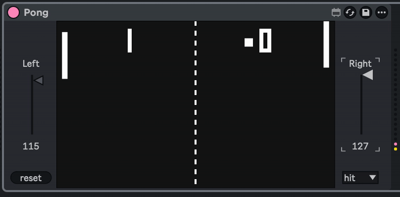
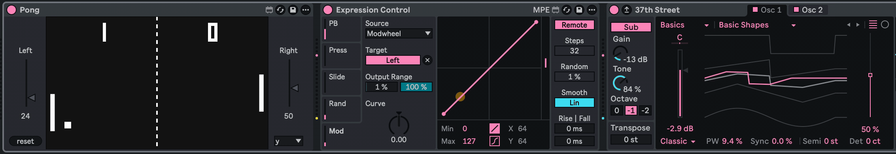

# Pong for Live
*Max for Live MIDI effect for Ableton 12*

## Usage
Download from releases and drag into Ableton. 
Automate/Map sliders for maximum fun.
Output can be switched between events, x-pos and y-pos.
Position y and x are also output as CC1 and CC2.

